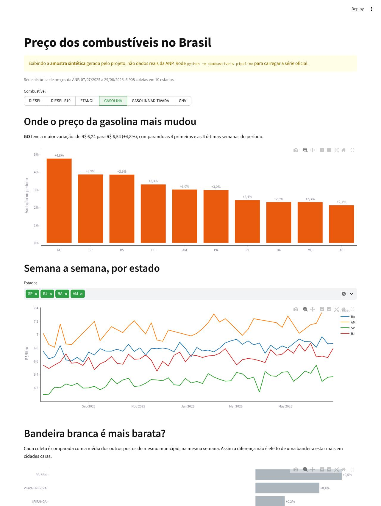
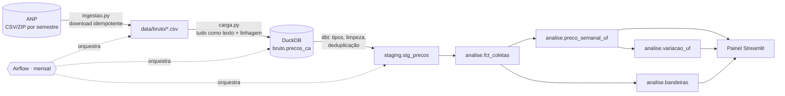

# Preço dos combustíveis no Brasil · pipeline de dados da ANP

Pipeline de ponta a ponta sobre a **Série Histórica de Preços de Combustíveis da ANP**: baixa os
arquivos semestrais, carrega no DuckDB, modela e testa com dbt, orquestra com Airflow e mostra o
resultado num painel em Streamlit. Roda inteiro na sua máquina, sem conta em nuvem.


<sub>Captura feita com a amostra sintética do projeto (veja "Rodar sem internet").</sub>

## Perguntas que o projeto responde

- **Onde o preço mais mudou?** Variação por estado e combustível no período carregado.
- **Como o preço evoluiu, semana a semana?** Média, mediana, mínimo e máximo por estado.
- **Posto de bandeira branca é mesmo mais barato?** Cada coleta é comparada com a média dos
  concorrentes do mesmo município, na mesma semana. Assim a diferença não vem de uma bandeira
  estar mais presente em cidades caras ou baratas.

## Arquitetura



| Camada | Onde | O que acontece |
| --- | --- | --- |
| Ingestão | `combustiveis/ingestao.py` | Baixa cada semestre, extrai o zip, trata as exceções históricas no nome dos arquivos. |
| Bruta | `combustiveis/carga.py` → `bruto.precos_ca` | Guarda o CSV como texto, exatamente como veio, com `_arquivo`, `_hash` e `_carregado_em`. |
| Staging | `transformacao/models/staging` | Tipa, padroniza produto e CNPJ, descarta linhas sem preço e remove duplicatas. |
| Análise | `transformacao/models/marts` | Fato de coletas e três tabelas, uma por pergunta. |
| Orquestração | `dags/combustiveis_anp.py` | Airflow 3, todo dia 16: baixar → carregar → `dbt build`. |
| Visualização | `painel/app.py` | Streamlit lendo as tabelas de análise. |

## Como rodar

Precisa de Python 3.11+.

```bash
git clone https://github.com/BrunoSakamoto/combustiveis-anp
cd combustiveis-anp
python -m venv .venv && source .venv/bin/activate   # Windows: .venv\Scripts\activate
pip install -e ".[painel,dev]"
```

**Com os dados reais da ANP**

```bash
python -m combustiveis pipeline --desde 2025-1   # baixa, carrega e roda o dbt com os testes
streamlit run painel/app.py                       # http://localhost:8501
```

**Rodar sem internet**

```bash
python -m combustiveis amostra   # gera dados sintéticos no formato exato da ANP, em um banco separado
streamlit run painel/app.py
```

A amostra fica em `data/amostra.duckdb` e nunca se mistura aos dados reais. O painel avisa quando
está mostrando a amostra.

**Com o Airflow (Docker)**

```bash
docker compose up --build
```

O Airflow abre em http://localhost:8080 (sem login, para uso local) e o painel em
http://localhost:8501. Na primeira vez, dispare a DAG `combustiveis_anp` manualmente. No Linux,
rode `echo "AIRFLOW_UID=$(id -u)" > .env` antes, para os arquivos gerados ficarem com o seu usuário.

## Decisões de engenharia

- **Idempotência em cada etapa.** Um semestre antigo não é baixado de novo. O semestre corrente
  sempre é, porque a ANP o atualiza todo mês. Na carga, um arquivo com o mesmo hash é pulado, e um
  arquivo alterado tem suas linhas antigas apagadas antes da nova inserção, na mesma transação.
  Rodar o pipeline duas vezes dá o mesmo resultado.
- **Camada bruta como texto.** A carga não interpreta nada: tipos e limpeza ficam no dbt, onde são
  versionados e testados. Se a ANP mudar o formato, os dados continuam entrando e um teste avisa.
- **Formato que varia entre anos.** Cabeçalhos com e sem acento, UTF-8 com BOM ou Latin-1,
  separador detectado pelo cabeçalho. Tudo é mapeado para nomes canônicos.
- **Testes de qualidade que pegam problemas reais.** Além de `not_null` e valores aceitos:
  - preço dentro de uma faixa plausível;
  - chave única (posto, produto, dia);
  - alerta quando a limpeza descarta mais de 2% de um arquivo (sinal de mudança de formato);
  - alerta quando uma coleta não pertence ao semestre do arquivo (pega dia e mês trocados).

  Produto novo gera aviso em vez de quebrar o pipeline.
- **DuckDB aceita um escritor por vez.** As tarefas da DAG rodam em sequência, e o painel abre o
  banco só para leitura e espera se o pipeline estiver gravando.
- **A DAG só orquestra.** Toda a lógica vive no pacote `combustiveis`. O mesmo código roda pela
  linha de comando, no Airflow e no CI.

## O que os dados reais mostraram

Rodando com a série de 2024 a 2026 (cerca de 2,1 milhões de coletas), os testes de qualidade
acenderam dois avisos. O comando `python -m combustiveis qualidade` mostra a causa de cada um:

- **Linhas vazias no arquivo da ANP.** O `ca-2025-01.csv` traz 9.114 linhas só com separadores
  (2,1% do arquivo). Não são registros perdidos: o relatório as conta à parte, e o teste de
  descarte só considera linhas com algum dado.
- **Coletas com preço provavelmente errado.** Exemplos: diesel S10 a R$ 9,99 em Ourinhos, ou
  um único posto do Guarujá com etanol acima de R$ 6 por semanas seguidas, mais de 60% acima do
  resto do estado. Elas continuam na tabela de fatos, como a ANP publicou, marcadas em
  `fora_da_curva`, e ficam fora das médias.

  A regra precisou de duas iterações. Comparar com a média do município escondia o erro, porque
  o próprio valor errado puxa a média. Comparar só com a mediana do estado marcava cidades
  distantes que são caras de verdade: em Santarém (PA), três postos cobravam o mesmo etanol a
  R$ 6,60, 61% acima da mediana do Pará. A regra final marca a coleta quando ela está longe da
  mediana do estado **e** da mediana do próprio município; com menos de 3 coletas no município
  na semana, vale só o critério do estado. Os três cenários são testes unitários do dbt.

## Testes

```bash
pytest -v
```

Cobrem as regras de semestre e de URL, a idempotência do download e da carga, os dois encodings,
e um teste ponta a ponta: amostra → DuckDB → `dbt build` com todos os testes de qualidade.
O dbt tem ainda testes unitários (`transformacao/models/marts/_marts.yml`) que validam a regra de
`fora_da_curva` com linhas fixas: posto isolado com preço errado, cidade cara com postos
concordando e cidade com só dois postos.
O GitHub Actions roda lint e testes a cada push.

## Estrutura

```
combustiveis/        ingestão, carga, amostra sintética e linha de comando
transformacao/       projeto dbt (staging, análise, testes de qualidade)
dags/                DAG do Airflow
painel/              painel Streamlit
tests/               pytest
docker/              imagens do Airflow e do painel
```

## Fonte dos dados

[ANP, Série Histórica de Preços de Combustíveis](https://www.gov.br/anp/pt-br/centrais-de-conteudo/dados-abertos/serie-historica-de-precos-de-combustiveis).
Levantamento semanal de preços em postos de todo o país, publicado por semestre.

---

Feito por [Bruno Araújo Sakamoto](https://www.linkedin.com/in/bruno-a-sakamoto/).
